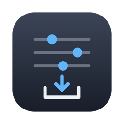

# Mac 備份

重灌 Mac 前的一鍵備份工具：**設定檔類打成 tar.gz 快照、大檔資料夾用 rsync 增量同步**，目的地自選（外接硬碟或 NAS 掛載資料夾）。內建清單即備份計畫本身，涵蓋 Lightroom 風格檔、開發環境、Claude / Hermes 設定與大檔資料。

> 前身為「LR 風格檔備份」（只備份 Lightroom presets），2026-08 擴建為全機備份工具，Lightroom 群組保留為其中一項。

## 使用

雙擊 **`Mac 備份.app`**（原生 SwiftUI app）：

1. **選擇備份目的地**：外接硬碟或 NAS 資料夾（記住選擇；未掛載時按鈕自動停用）
2. 按 **「完整備份（設定＋大檔）」** 或 **「只備份設定檔」**（快，不含大檔同步）
3. 還原：從快照清單選取 → 「還原選取的快照」（解回原始位置，覆蓋同名檔、不刪其他檔案）

> 原始碼在 `swift-app/Sources/`，重新編譯（只需 Command Line Tools，不需 Xcode）：`swift-app/build.sh`
>
> 註：狀態集中在 `AppModel`（`@StateObject`/`@Published`）。本機已裝 Xcode 27，`@State` 可以正常編譯（2026-10-13 用 `swiftc` 實測）；只裝 Command Line Tools 的機器可能缺 SwiftUIMacros plugin，`@State` 會編譯失敗。

## 備份範圍

### 設定檔快照（tar.gz → `<目的地>/snapshots/<key>-<timestamp>.tar.gz`）

| 群組 | 內容 |
|------|------|
| `pkg-snapshots` | `brew bundle dump` 產生的 Brewfile（含 formula / cask / App Store 項目）＋ `mas list` 純文字快照 |
| `lr-presets` | Lightroom 風格檔：`~/Library/Application Support/Adobe/` 下的 `Lightroom/`、`CameraRaw/Settings`（film packs＋個人 presets）、`Defaults`（含最愛 `FavoriteStyles.xmp`）、`CameraProfiles`、`LensProfiles` 等。不含 ModelZoo（AI 模型）、Logs、GPU cache |
| `dev-env` | `~/.ssh`（含私鑰）、`.gitconfig`、`.zshrc`、`.zprofile`、`.p10k.zsh`、`.oh-my-zsh/custom` |
| `claude` | `~/.claude/projects`（全部 Cowork 對話＋memory）、settings、CLAUDE.md、skills、commands、plugins（排除 cache）、`~/.claude.json`、Claude Desktop 的 `claude_desktop_config.json` 與 Extensions Settings |
| `hermes` | `~/.hermes/` 的 config.yaml、auth.json、Google OAuth 憑證、memories（長期記憶）、mcp-tokens、skills |

### 大檔同步（rsync -a 增量 → `<目的地>/sync/<資料夾名>/`）

`Pictures`（Lightroom catalog＋RAW；排除 `Photos Library.photoslibrary`，照片圖庫由 iCloud 照片負責）、`Desktop`、`Documents`、`Downloads`。（音樂不備份——串流服務即可。）

- 不加 `--delete`：只增量寫入，**絕不刪除目的地既有檔案**
- 第一次跑很久（照片 80G+），之後增量會快很多

## 還原

- **設定檔快照**：App 內選取還原，依檔名前綴自動解回原始位置（例：`claude-*` 解回 `~`、`hermes-*` 解回 `~/.hermes`）
- **`pkg-snapshots`**：不支援 App 內還原——重灌後手動 `brew bundle install --file=Brewfile`
- **大檔**：直接從目的地 `sync/` 資料夾用 Finder 拷回，不經 App（避免自動反向覆蓋風險）

## 重灌流程建議

### 重灌前

1. 接上備份碟 → 開 App → 完整備份，確認各項目都顯示「完成」
2. 抽查目的地：`snapshots/` 有各群組 tar.gz、`sync/` 有各資料夾

### 重灌後還原——需要先裝什麼？

**還原快照本身不需要預裝任何東西**：本 App 是獨立編譯的二進位檔，tar / rsync 都是 macOS 內建。而且 App 本身就在大檔備份裡（`sync/Documents/Claude playground/Personal Project/lr-presets-backup/Mac 備份.app`），**直接從備份碟雙擊即可執行**，不用先還原任何東西。

依賴順序整理：

| 步驟 | 前置需求 |
|------|----------|
| 還原設定檔快照（App 內） | 無——直接從備份碟開 App |
| 大檔拷回（Finder） | 無 |
| `brew bundle install` | 先裝 [Homebrew](https://brew.sh)（安裝器會自動帶入 Command Line Tools）；App Store 項目（mas）需先登入 Apple 帳號 |
| Claude Code / Hermes 本體 | 還原的只是設定與資料，程式本體要重新安裝（Claude Code 走官方安裝方式；Hermes 走它的 setup script），裝完設定就位 |

### 建議順序

1. 登入 Apple 帳號（iCloud + App Store）
2. 從備份碟直接開 `Mac 備份.app` → 還原各設定檔快照（dev-env / claude / hermes / lr-presets）
3. 大檔從 `sync/` 用 Finder 拷回家目錄對應位置（Pictures / Desktop / Documents / Downloads）
4. 裝 Homebrew → 解開 `pkg-snapshots` 快照 → `brew bundle install --file=Brewfile`
5. 重新安裝 Claude Code、Claude Desktop、Hermes 等程式本體（設定已在步驟 2 就位）
6. 重新授權 macOS 自動化權限：系統設定 → 隱私權與安全性 → 自動化（Claude 對 Outlook / Calendar 的控制，第一次執行排程會失敗屬正常）；Cowork 首次操作本機 CLI 也會重新跳授權
7. 各訂閱制軟體（Adobe / Office / 1Password / Spotify…）登入帳號即回復，無需還原檔案

## 權限（避免逐資料夾詢問）

未沙盒化 app 存取「桌面／文件／照片／外接碟」時，macOS 預設**逐分類**跳權限詢問。解法：授權一次「**完整磁碟取用權**（Full Disk Access）」——App 的「備份」分頁會自動偵測，未授權時顯示引導橫幅，一鍵開啟系統設定對應頁面。授權後重開 App 生效，之後不再詢問。

> 開發注意：本 App 用 ad-hoc 簽章（`codesign --sign -`），**每次重新編譯簽章身分都會改變，macOS 會把它當成新 App，已授權的權限全部重置**。所以請在確定不再改 code 之後才授權 FDA；日常修改重編後需要重新授權一次。

## 安全性

- 備份為唯讀複製，不修改／刪除任何來源資料
- 還原覆蓋同名檔，但**不刪除**其他既有檔案；還原 `lr-presets` 前請先關閉 Lightroom Classic
- **備份碟請自行妥善保管**：快照內含 SSH 私鑰、OAuth token、對話紀錄等敏感內容（不加密，只放自家 NAS 或加密外接碟）
